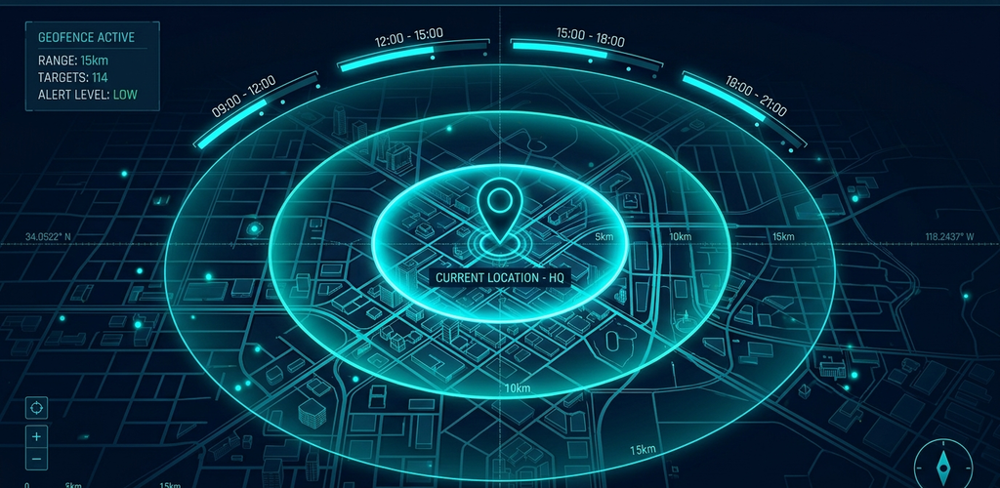
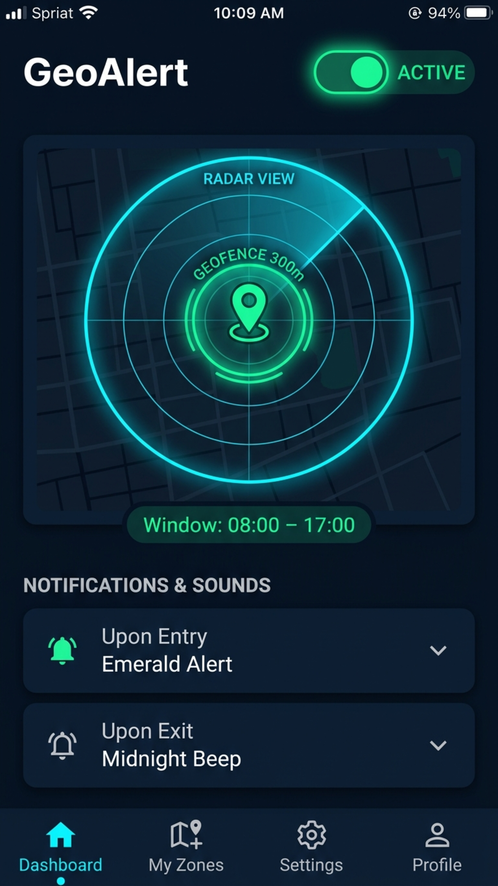
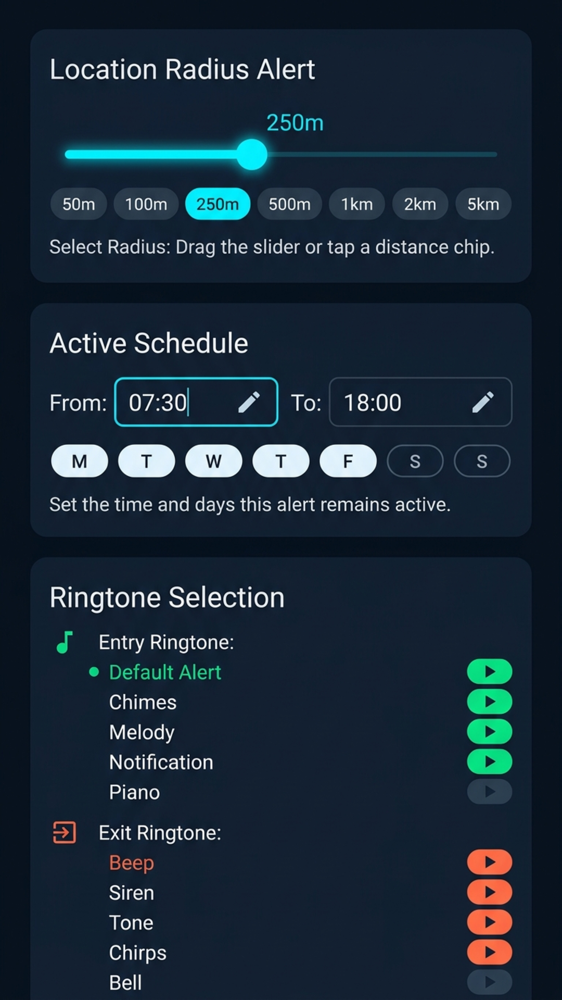

# קבצים גרפיים לחנות Google Play – בזמן הנכון (GeoAlert)

ניתן ללחוץ **לחיצה ימנית על כל תמונה מתחת -> "שמור תמונה בשם..." (Save image as...)** כדי לשמור אותה ישירות למחשב ולהעלות ל-Google Play Console:

---

## 1. סמל האפליקציה (App Icon – 512×512 PNG)

---

## 2. תמונת נושא לחנות (Feature Graphic – 1024×500 PNG)

---

## 3. צילום מסך 1 לטלפון (Phone Screenshot 1 – 1080×1920 PNG)

---

## 4. צילום מסך 2 לטלפון (Phone Screenshot 2 – 1080×1920 PNG)

